# GitHub Width Handle

A small Chrome extension that adds a drag handle to the main content column on GitHub detail pages, so dense issues and PRs can use more of a large display.


## Screenshots

### Beside the first comment

The handle sits in the gutter between the comments and the sidebar, with the reset **×** under it and the rail running along the content. It starts level with the top of the first comment.

| Light | Dark |
| --- | --- |
| 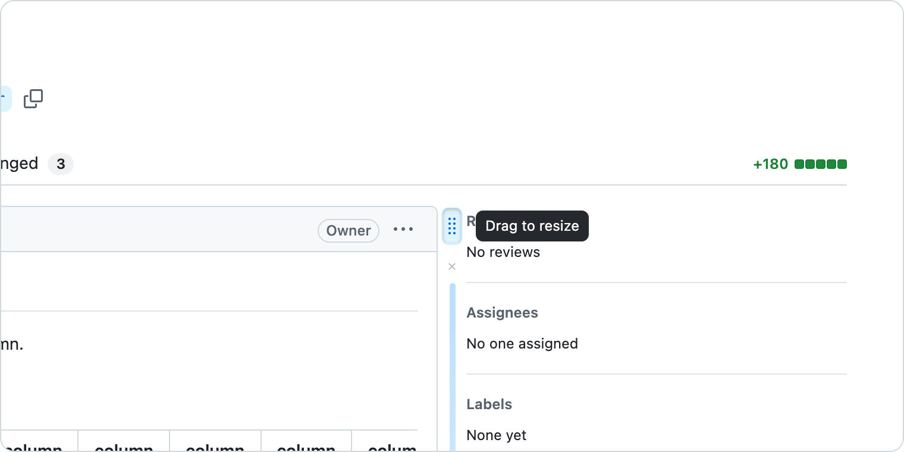 | 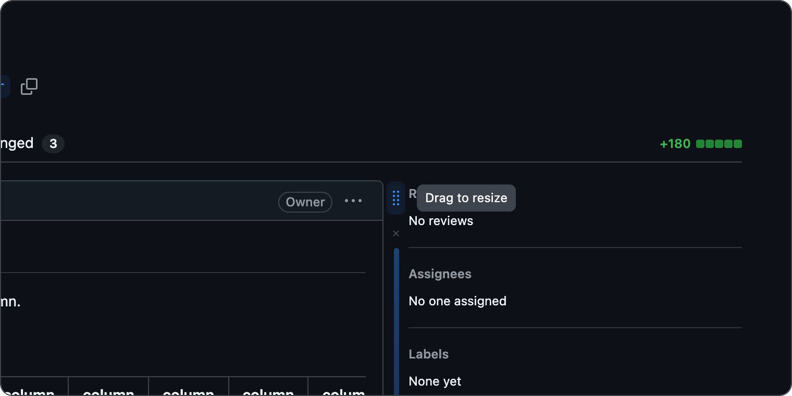 |

### Scrolled down a long page

As you scroll, the handle stays at the middle of the window.

| Light | Dark |
| --- | --- |
| 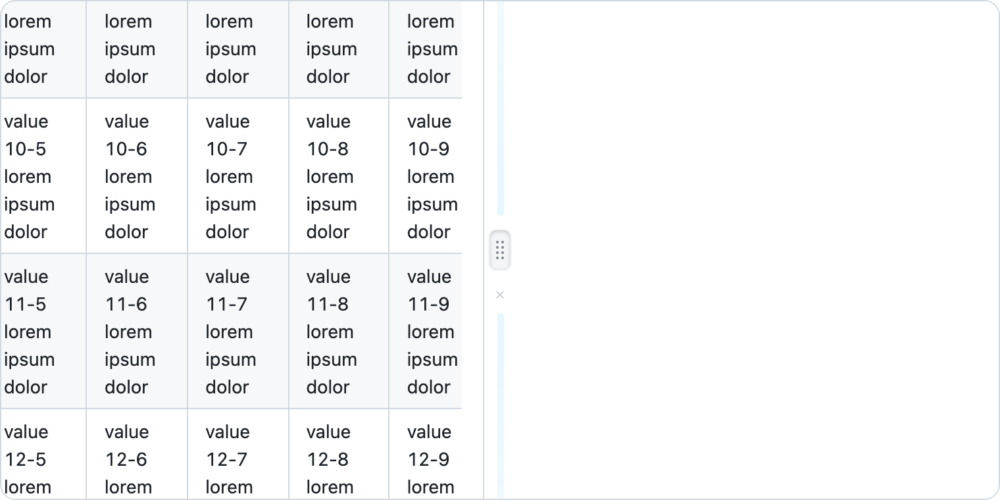 | 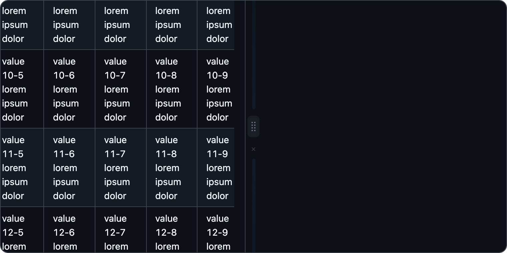 |

### Settings popup

The popup follows your system's light or dark setting.

| Light | Dark |
| --- | --- |
| 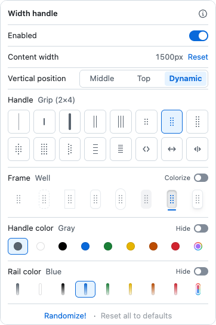 | 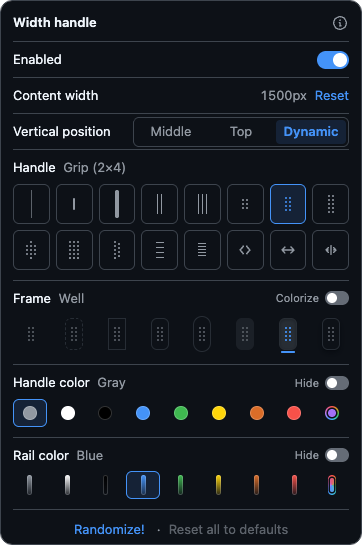 |

### Color combinations

Fifteen randomized combinations of handle graphic, frame, handle color and rail color, all shown at rest (75% opacity). Open either theme below.

<details>
<summary><b>Light theme</b></summary>
<br>

<table>
  <tr><td align="center" valign="top">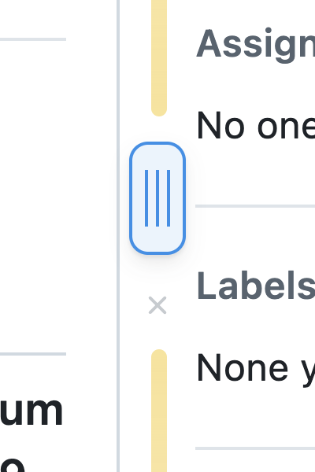<br><sub>Triple line · Raised (colorized) · Blue · Yellow rail</sub></td><td align="center" valign="top">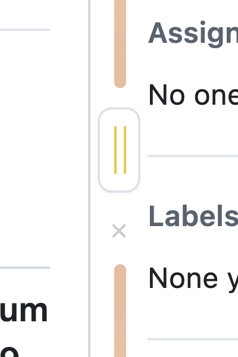<br><sub>Double line · Rounded · Yellow · Orange rail</sub></td><td align="center" valign="top">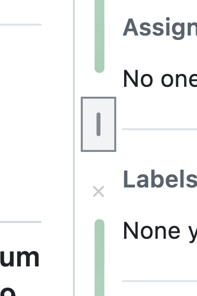<br><sub>Dash · Square (colorized) · Gray · Green rail</sub></td><td align="center" valign="top">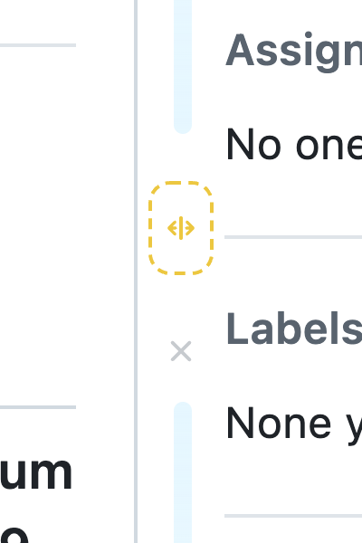<br><sub>Resize cursor · Dashed (colorized) · Yellow · Blue rail</sub></td><td align="center" valign="top">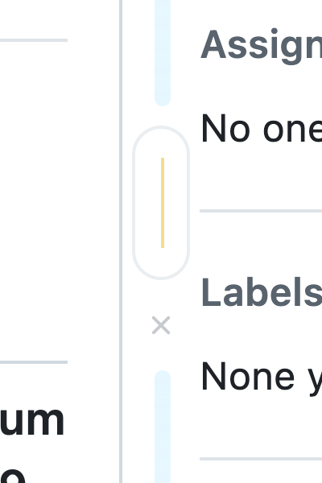<br><sub>Hairline · Capsule · Yellow · Blue rail</sub></td></tr>
  <tr><td align="center" valign="top">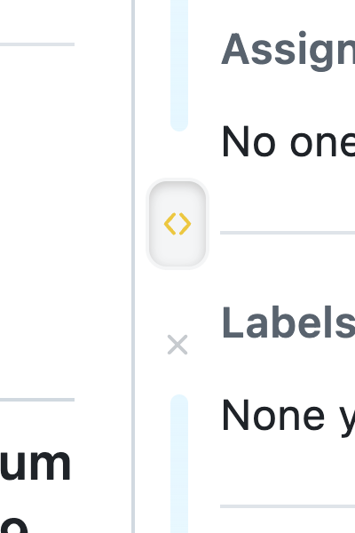<br><sub>Arrows · Well · Yellow · Blue rail</sub></td><td align="center" valign="top">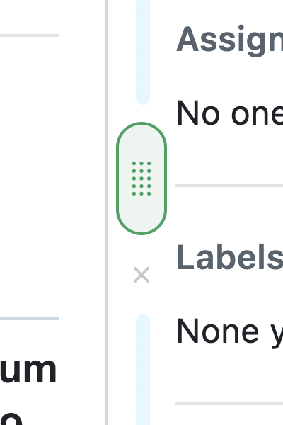<br><sub>Dot grid (3×5) · Capsule (colorized) · Green · Blue rail</sub></td><td align="center" valign="top">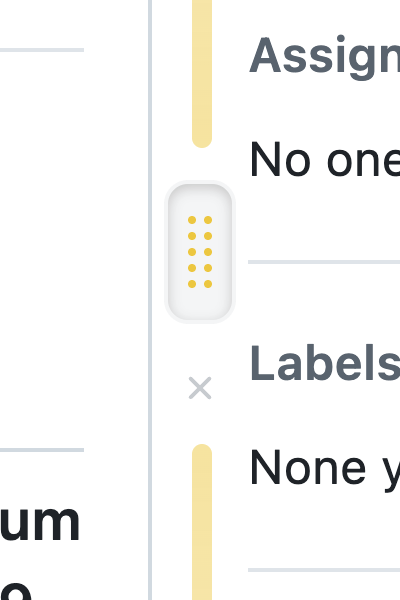<br><sub>Grip (2×5) · Well · Yellow · Yellow rail</sub></td><td align="center" valign="top">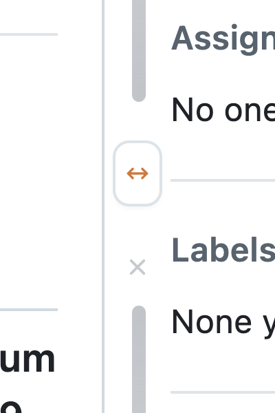<br><sub>Double arrow · Rounded · Orange · Gray rail</sub></td><td align="center" valign="top">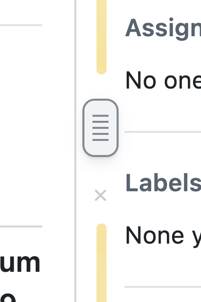<br><sub>Ridges (5) · Raised (colorized) · Gray · Yellow rail</sub></td></tr>
  <tr><td align="center" valign="top">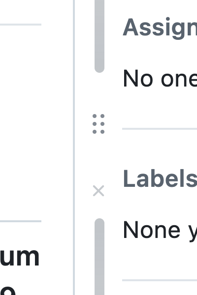<br><sub>Grip (2×3) · no frame · Gray · Gray rail</sub></td><td align="center" valign="top">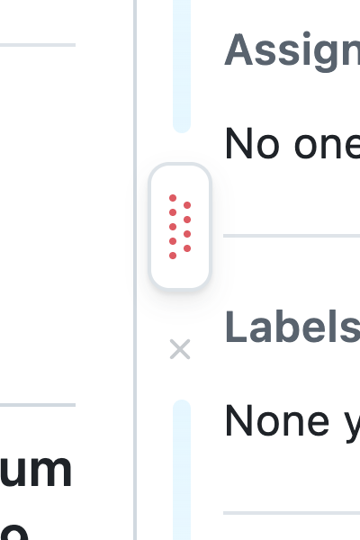<br><sub>Staggered dots · Raised · Red · Blue rail</sub></td><td align="center" valign="top">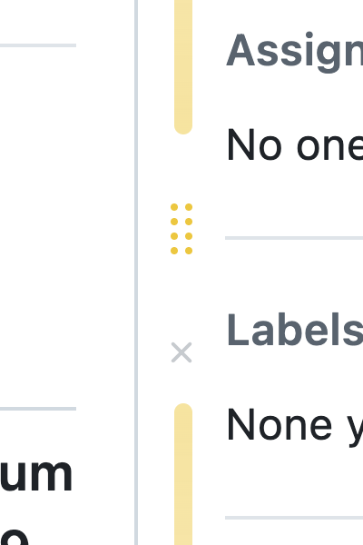<br><sub>Grip (2×4) · no frame · Yellow · Yellow rail</sub></td><td align="center" valign="top">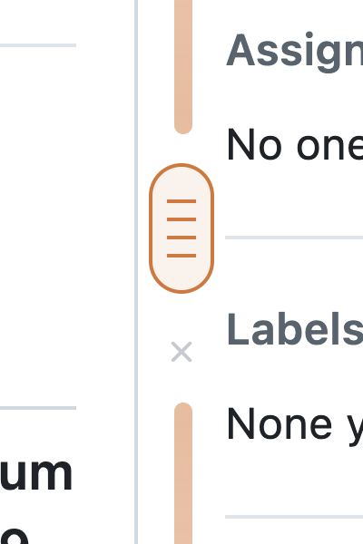<br><sub>Ridges (4, wide) · Capsule (colorized) · Orange · Orange rail</sub></td><td align="center" valign="top">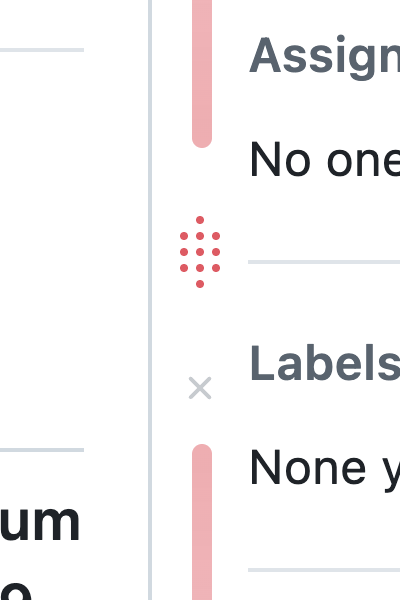<br><sub>Dots (3-5-3) · no frame · Red · Red rail</sub></td></tr>
</table>

</details>

<details>
<summary><b>Dark theme</b></summary>
<br>

<table>
  <tr><td align="center" valign="top">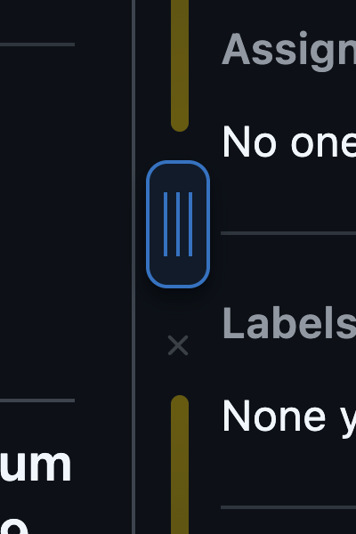<br><sub>Triple line · Raised (colorized) · Blue · Yellow rail</sub></td><td align="center" valign="top">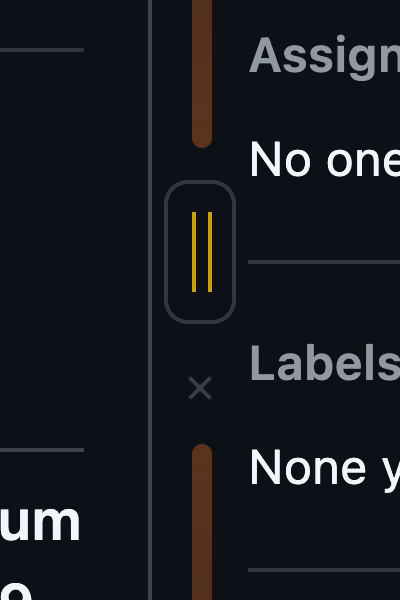<br><sub>Double line · Rounded · Yellow · Orange rail</sub></td><td align="center" valign="top">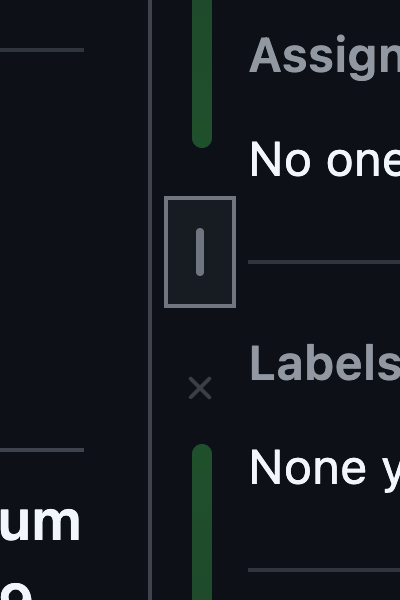<br><sub>Dash · Square (colorized) · Gray · Green rail</sub></td><td align="center" valign="top">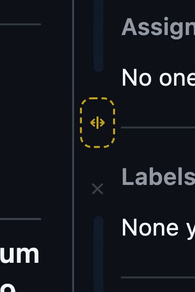<br><sub>Resize cursor · Dashed (colorized) · Yellow · Blue rail</sub></td><td align="center" valign="top">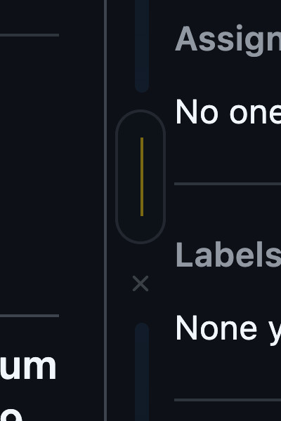<br><sub>Hairline · Capsule · Yellow · Blue rail</sub></td></tr>
  <tr><td align="center" valign="top">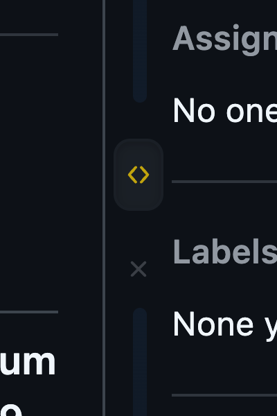<br><sub>Arrows · Well · Yellow · Blue rail</sub></td><td align="center" valign="top">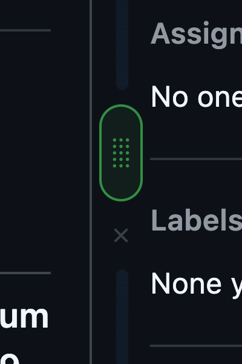<br><sub>Dot grid (3×5) · Capsule (colorized) · Green · Blue rail</sub></td><td align="center" valign="top">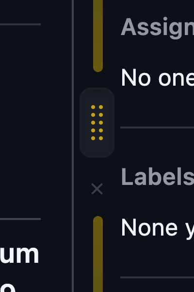<br><sub>Grip (2×5) · Well · Yellow · Yellow rail</sub></td><td align="center" valign="top">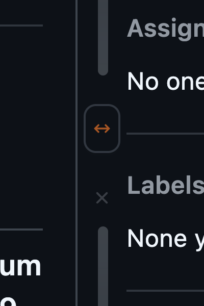<br><sub>Double arrow · Rounded · Orange · Gray rail</sub></td><td align="center" valign="top">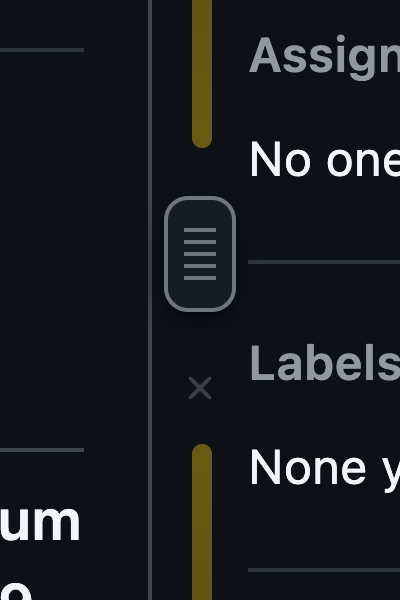<br><sub>Ridges (5) · Raised (colorized) · Gray · Yellow rail</sub></td></tr>
  <tr><td align="center" valign="top">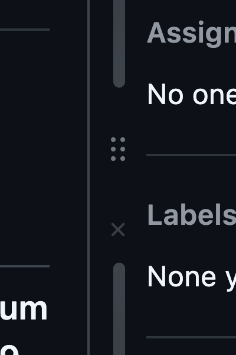<br><sub>Grip (2×3) · no frame · Gray · Gray rail</sub></td><td align="center" valign="top">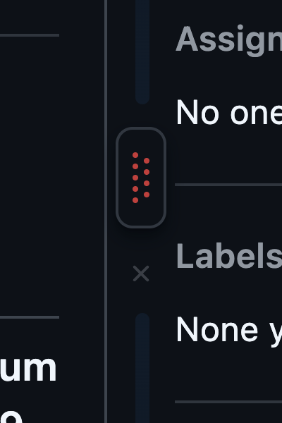<br><sub>Staggered dots · Raised · Red · Blue rail</sub></td><td align="center" valign="top">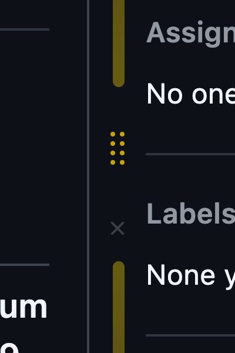<br><sub>Grip (2×4) · no frame · Yellow · Yellow rail</sub></td><td align="center" valign="top">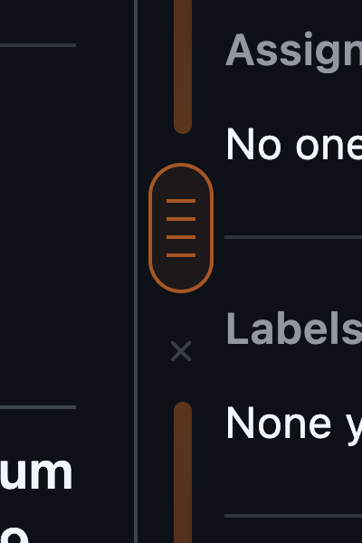<br><sub>Ridges (4, wide) · Capsule (colorized) · Orange · Orange rail</sub></td><td align="center" valign="top">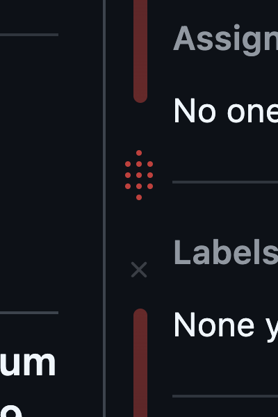<br><sub>Dots (3-5-3) · no frame · Red · Red rail</sub></td></tr>
</table>

</details>

## What it does

- Adds a grip in the gutter between the main column and the right sidebar.
- A faint rail runs along the content. By default it's the same blue as GitHub's highlighted comment headers.
  - It fades out away from the handle.
  - It stops below any pinned GitHub header.
  - On short pages it ends level with the Comment button instead of the bottom of the sidebar.
- **Drag** it to widen the column **from the center**: both sides grow equally, the sidebar slides outward (never overlapped), and headers and PR tabs stay aligned.
- Where the handle sits is your choice (see [Vertical position](#vertical-position)). By default it starts beside the first comment, then follows the vertical center of the window as you scroll, so it's always reachable.
- The handle, × and rail are dimmed to 75% opacity until you hover or use them.
- A small **×** under the handle (shown only when a custom width is set) eases back to GitHub's default width.
- The width is **global** and **synced** (`chrome.storage.sync`). It's applied before the page paints, so there's no snap on load or when moving between pages. If it can only be applied after the content is visible, it eases in over 0.5s.
- Keyboard: focus the handle and use <kbd>←</kbd> / <kbd>→</kbd> (hold <kbd>Shift</kbd> for bigger steps).
- The toolbar popup has:
  - an on/off toggle, the current width and Reset
  - the handle's vertical position
  - 16 handle graphics and 8 frames to put them in
  - handle and rail colors (8 presets plus a custom color picker), each with a **Hide** switch
  - **Randomize!**, which picks a random handle, frame, Colorize setting, handle color and rail color (and turns off Hide so the result is visible)
  - **Reset all to defaults**, which resets every style and position setting but keeps your width (use Reset next to the width for that)
  - a **Liquid glass (beta)** switch in the ⓘ panel, which restyles the popup itself with an Apple-style translucent look (it doesn't change the handle on GitHub)

  Changes apply live and are synced.

### Vertical position

- **Middle**: stays at the vertical center of the window. It never rises above the first comment, and on short pages it stops at the end of the content.
- **Top**: sits beside the first comment, with the top of the frame level with the top of the comment box, and scrolls away with the page.
- **Dynamic** (default): starts beside the first comment, then slides to the center once you scroll past it.

### Handle styles

The handle is a graphic inside an optional frame, picked separately.

**Graphics (16):** Hairline, Dash, Pill, Double line, Triple line, Grip (2×3), **Grip (2×4, default)**, Grip (2×5), Dots (3-5-3), Dot grid (3×5), Staggered dots, Ridges (4, wide), Ridges (5), Arrows, Double arrow and Resize cursor.

**Frames (8):** None, Dashed, Square, Rounded, Capsule, Filled, **Well (default)** and Raised. Frames are neutral gray by default. Turn on **Colorize** to tint the frame with the handle color. Bordered frames pick up the handle's hover color when you hover or drag.

The frame previews in the popup show your current graphic, so you can see the combination before choosing. The v1.0 "Knob" style becomes Grip (2×4) in a Rounded frame.

To add or change a graphic, edit [`src/handles.js`](src/handles.js). Frames are in [`src/frames.css`](src/frames.css).

### Colors

The handle and the rail each take one of eight presets: Gray, White, Black, Blue, Green, Yellow, Orange and Red. The presets use GitHub's own theme colors, so they adjust to light and dark mode.

The ninth, rainbow swatch is **Custom**. It opens a small picker with a saturation/brightness square, a hue slider, an alpha slider and a hex field (`#rgb`, `#rrggbb` or `#rrggbbaa`). The page updates live as you drag, and the color is saved when you let go or close the picker (<kbd>Esc</kbd>, **Done**, or a click outside). Custom colors are the same in light and dark mode.

- The default handle color is **Gray**, which turns blue on hover. Other colors keep their color on hover.
- The default rail color is **Blue**, a subtle match for GitHub's highlighted comment headers. The other rail colors are bolder (about 50% strength at rest) so a chosen color stands out. Use Custom if you want a different strength.
- **Hide** stops a part from being drawn. A hidden handle still works: hover the gap and drag as usual.

The palettes are in [`src/handles.js`](src/handles.js).

### Pages

| Applies to | Untouched |
| --- | --- |
| Issue detail (`/issues/123`) | Issue / PR lists |
| PR Conversation (`/pull/123`) | PR Checks, Files changed, single commits |
| PR Commits (`/pull/123/commits`) | Code, Actions, Projects, etc. |
| Discussion detail (`/discussions/123`) | Discussion lists |

## Install (unpacked)

No build step is needed. Chrome loads the folder directly.

1. Open `chrome://extensions` and turn on **Developer mode** (top right).
2. Click **Load unpacked** and select this repo folder (the one containing `manifest.json`).
3. Optional: pin it from the puzzle-piece menu in the toolbar to reach the popup.
4. Reload any GitHub tabs that were already open.

**Updating:** after pulling or editing code, click the ↻ reload icon on the extension's card in `chrome://extensions`, then reload GitHub tabs.

**Zip for another machine:** `npm run package` creates `github-width-handle.zip` containing only the extension files. Unzip it there and use **Load unpacked** on the unzipped folder. Chrome on macOS and Windows won't install self-packed `.crx` files from outside the Web Store, so unpacked is the way to go.

## Project layout

```
manifest.json     MV3 manifest
src/content.js    route detection, width application, handle + drag logic
src/content.css   scoped width overrides and handle styles (Primer CSS variables)
src/frames.css    handle frame styles, shared by the page and the popup
src/handles.js    settings: handle graphics, frames, palettes, defaults; shared by the page and the popup
src/popup.*       toolbar popup
src/glass.css     Liquid glass (beta) popup theme
src/popup-theme.js applies the cached popup theme before first paint
icons/            extension icons
docs/             README screenshots
tests/            Playwright end-to-end checks against live github.com
```

No build step. Plain JS and CSS.

## Testing

```sh
npm install
npx playwright install chromium
npm test            # headless; HEADED=1 npm test to watch
```

The suite loads the unpacked extension in Chromium and runs against test content in this repo: a dense issue (#1), a PR (#2), a discussion (#3) and a short issue (#5). It checks:

- the width is applied before first paint and across soft navigations
- columns widen symmetrically without covering the sidebar
- the three handle positions (middle, top, dynamic) and the idle fade
- the rail's extent: below pinned headers, and ending at the Comment button on short pages
- the handle graphic, frame, Colorize, color, custom picker, Hide and Randomize controls, the Knob migration, and Reset all
- the reset and late-apply animations
- keyboard resizing, the popup controls, and pages that should be left untouched

Test screenshots are written to `tests/screenshots/` (git-ignored). The README images in `docs/` are separate and committed.

## How it works

GitHub's detail pages center a fixed `max-width` container (1280px) that holds the main column and the sidebar. The extension raises that container's `max-width` through a CSS variable (`--gwh-width`), plus a couple of inner caps (e.g. the PR timeline's 1012px). Because it stays `margin: auto` centered, it grows equally on both sides while the sidebar keeps its own width.

All rules are scoped under `html[data-gwh-page][data-gwh-sized]`. The content script sets those attributes at `document_start` from a `localStorage` copy of the synced setting, so the CSS applies as soon as GitHub renders.
